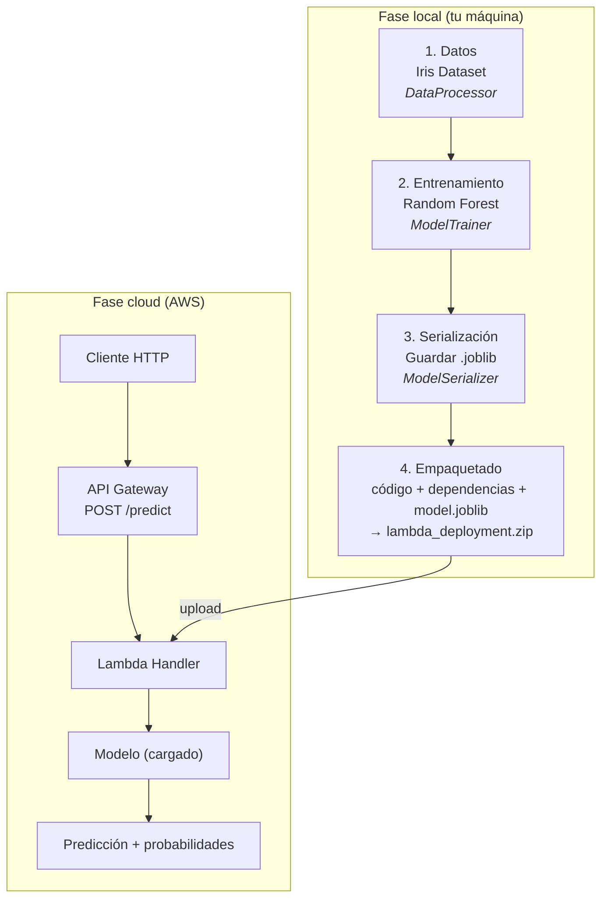
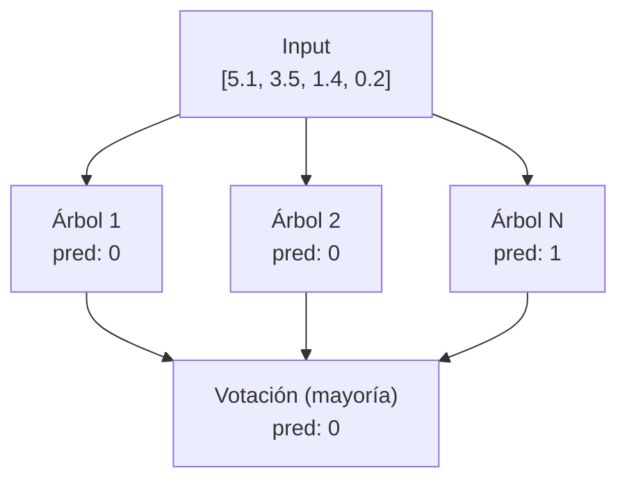
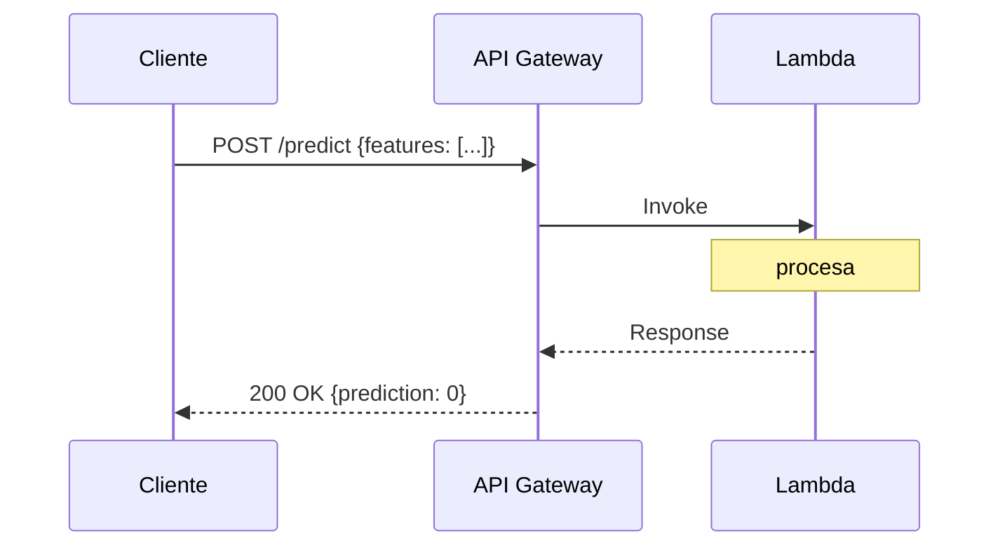
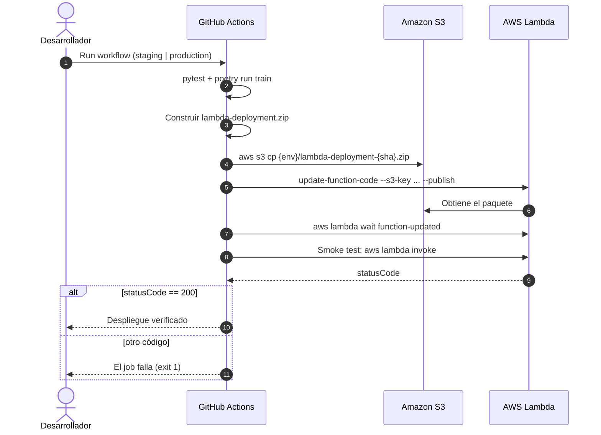
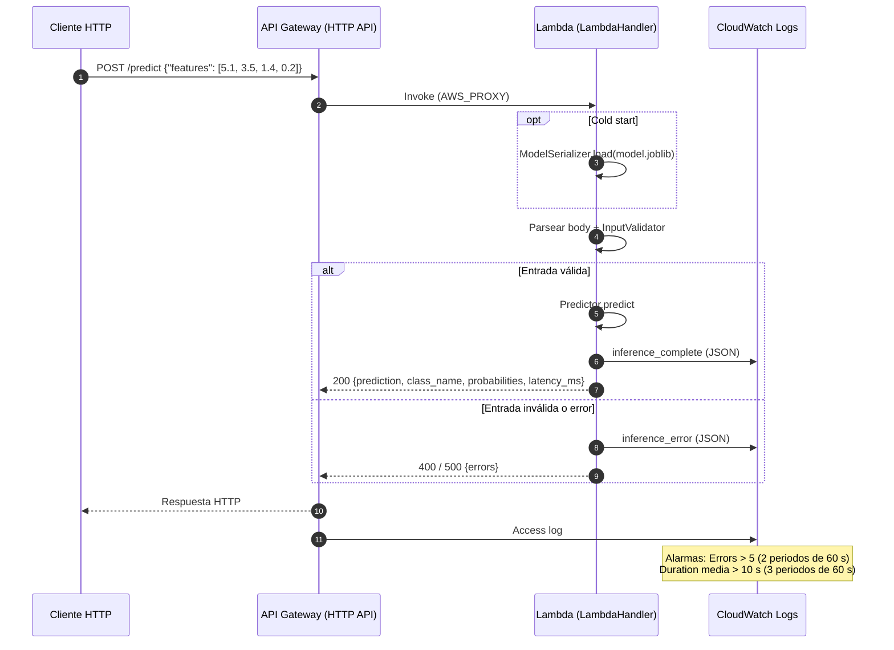

# Guía de Arquitectura: ML Lambda Deployment

Esta guía explica cómo funciona el proyecto, los conceptos clave y el flujo de datos.

## Tabla de Contenidos

1. [Visión General](#visión-general)
2. [Flujo del Proyecto](#flujo-del-proyecto)
3. [Estructura de Módulos](#estructura-de-módulos)
4. [Conceptos Clave](#conceptos-clave)
5. [Flujo de Datos Detallado](#flujo-de-datos-detallado)
6. [AWS Lambda y Serverless](#aws-lambda-y-serverless)
7. [Flujo de AWS](#flujo-de-aws)

---

## Visión General

Este proyecto tiene **dos fases** claramente separadas:

| Fase              | Dónde se ejecuta | Qué hace                                            |
| ----------------- | ---------------- | --------------------------------------------------- |
| **Entrenamiento** | Tu máquina local | Prepara datos, entrena modelo, lo guarda            |
| **Inferencia**    | AWS Lambda       | Carga modelo, recibe requests, retorna predicciones |

### ¿Por qué esta separación?

- **Entrenamiento** requiere más recursos (CPU/RAM) y se hace una vez
- **Inferencia** debe ser rápida y escalable, ideal para serverless
- El modelo entrenado es el "puente" entre ambas fases

---

## Flujo del Proyecto



---

## Estructura de Módulos

```
src/ml_lambda/
│
├── config.py              # 🔧 Configuración centralizada
│                          #    Todos los parámetros en un solo lugar
│
├── data/
│   └── processor.py       #  DataProcessor
│                          #    - load_iris(): carga dataset
│                          #    - split_data(): divide train/test
│                          #    - normalize(): escala features
│
├── training/
│   ├── trainer.py         #  ModelTrainer
│   │                      #    - train(): entrena RandomForest
│   │                      #    - Validación cruzada incluida
│   │
│   └── evaluator.py       #  ModelEvaluator
│                          #    - evaluate(): métricas (accuracy, f1, etc.)
│                          #    - Matriz de confusión
│
├── model/
│   └── serializer.py      #  ModelSerializer
│                          #    - save(): guarda modelo + metadatos
│                          #    - load(): carga con validación
│                          #    - Hash SHA256 para integridad
│
├── inference/
│   ├── handler.py         #  LambdaHandler (entry point)
│   │                      #    - handle(): procesa requests
│   │                      #    - Cold start optimization
│   │
│   ├── validator.py       #  InputValidator
│   │                      #    - Valida formato de entrada
│   │                      #    - Sanitiza inputs
│   │
│   └── predictor.py       #  Predictor
│                          #    - predict(): ejecuta inferencia
│
├── utils/
│   ├── logging.py         #  StructuredLogger
│   │                      #    - Logs en formato JSON
│   │                      #    - Compatible con CloudWatch
│   │
│   └── exceptions.py      #  Excepciones personalizadas
│                          #    - DataValidationError
│                          #    - ModelNotFoundError, etc.
│
└── deploy/
    └── packager.py        #  PackageBuilder
                           #    - Crea ZIP para Lambda
                           #    - Excluye archivos innecesarios
```

---

## Conceptos Clave

### 1. Dataset Iris

El dataset Iris es un clásico en ML. Contiene 150 muestras de flores con:

| Feature      | Descripción           | Rango típico |
| ------------ | --------------------- | ------------ |
| sepal_length | Largo del sépalo (cm) | 4.0 - 8.0    |
| sepal_width  | Ancho del sépalo (cm) | 2.0 - 4.5    |
| petal_length | Largo del pétalo (cm) | 1.0 - 7.0    |
| petal_width  | Ancho del pétalo (cm) | 0.1 - 2.5    |

**Clases (lo que predecimos):**

- 0: Setosa
- 1: Versicolor
- 2: Virginica

### 2. Random Forest

Es un "ensemble" de árboles de decisión:



**¿Por qué Random Forest?**

- Robusto (no overfitting fácil)
- No requiere mucho tuning
- Funciona bien con datasets pequeños
- Provee probabilidades por clase

### 3. Serialización con Joblib

Joblib es más eficiente que pickle para arrays numpy:

```python
# Guardar
joblib.dump(model, 'model.joblib')

# Cargar
model = joblib.load('model.joblib')
```

**¿Por qué no pickle?**

- Joblib comprime mejor arrays grandes
- Más rápido para objetos con numpy arrays
- Estándar en scikit-learn

### 4. Cold Start en Lambda

Cuando Lambda no ha sido invocada recientemente, AWS debe:

1. Descargar el código
2. Inicializar el runtime (Python)
3. Ejecutar código de inicialización

```python
# FUERA del handler - se ejecuta en cold start
_handler = LambdaHandler()  # Carga modelo aquí

def lambda_handler(event, context):
    # DENTRO del handler - se ejecuta en cada request
    return _handler.handle(event, context)
```

**Optimización:** Cargamos el modelo UNA vez (cold start) y lo reutilizamos.

### 5. API Gateway + Lambda



**API Gateway maneja:**

- Routing (POST /predict)
- CORS
- Throttling
- Transformación de requests

**Lambda maneja:**

- Lógica de negocio
- Carga del modelo
- Predicción

---

## Flujo de Datos Detallado

### Fase de Entrenamiento

```python
# 1. Cargar datos
processor = DataProcessor()
X, y = processor.load_iris()

# 2. Dividir datos (80% train, 20% test)
X_train, X_test, y_train, y_test = processor.split_data(X, y)

# 3. Normalizar
X_train = processor.normalize(X_train, fit=True)   # fit=True: aprende parámetros
X_test = processor.normalize(X_test, fit=False)    # fit=False: usa parámetros aprendidos

# 4. Entrenar
trainer = ModelTrainer(TrainingConfig(n_estimators=100))
result = trainer.train(X_train, y_train)

# 5. Evaluar
evaluator = ModelEvaluator()
metrics = evaluator.evaluate(result.model, X_test, y_test)
print(f"Accuracy: {metrics.accuracy}")

# 6. Guardar
serializer = ModelSerializer()
serializer.save(result.model, metadata, Path("artifacts/model.joblib"))
```

### Fase de Inferencia (en Lambda)

```python
# Request de API Gateway
event = {
    "body": '{"features": [5.1, 3.5, 1.4, 0.2]}',
    "httpMethod": "POST"
}

# 1. Parsear body
body = json.loads(event["body"])
# body = {"features": [5.1, 3.5, 1.4, 0.2]}

# 2. Validar entrada
validator = InputValidator()
result = validator.validate(body)
# result.is_valid = True
# result.sanitized_input = {"features": [5.1, 3.5, 1.4, 0.2]}

# 3. Predecir
features = result.sanitized_input["features"]
prediction = model.predict([features])[0]        # 0
probabilities = model.predict_proba([features])  # [[0.95, 0.03, 0.02]]

# 4. Responder
response = {
    "statusCode": 200,
    "body": json.dumps({
        "prediction": 0,
        "class_name": "setosa",
        "probabilities": [0.95, 0.03, 0.02],
        "latency_ms": 12.5
    })
}
```

---

## AWS Lambda y Serverless

### ¿Qué es Serverless?

No significa "sin servidores", sino que **tú no gestionas servidores**:

| Tradicional           | Serverless          |
| --------------------- | ------------------- |
| Provisionar EC2       | AWS lo hace         |
| Instalar dependencias | Incluidas en ZIP    |
| Escalar manualmente   | Auto-scaling        |
| Pagar 24/7            | Pagar por ejecución |

### Límites de Lambda

| Recurso               | Límite           |
| --------------------- | ---------------- |
| Tamaño ZIP (directo)  | 50 MB            |
| Tamaño ZIP (desde S3) | 250 MB           |
| Imagen Docker         | 10 GB            |
| Memoria               | 128 MB - 10 GB   |
| Timeout               | 15 minutos máx   |
| Concurrencia          | 1000 por defecto |

### ¿Por qué ZIP y no Docker?

Para este proyecto usamos ZIP porque:

- Modelo pequeño (~1 MB)
- Dependencias ligeras (~40 MB)
- Más simple de entender
- Despliegue más rápido

Docker es mejor cuando:

- Modelo grande (>50 MB)
- Dependencias complejas
- Necesitas sistema operativo específico

---

## Flujo de AWS

Recursos provisionados por [`infrastructure/main.tf`](../infrastructure/main.tf): Lambda (`python3.12`, 512 MB, 30 s), API Gateway HTTP API (`POST /predict`, `GET /health`), bucket S3 versionado para los paquetes, rol IAM de ejecución, grupos de logs y alarmas de CloudWatch.

La versión editable de la arquitectura y de este flujo, con iconos de AWS, está en [`diagrams/architecture.drawio`](diagrams/architecture.drawio) (páginas «Arquitectura» y «Flujo AWS»).

### Despliegue

Flujo del workflow manual [`deploy.yml`](../.github/workflows/deploy.yml):



### Inferencia



---

## Próximos Pasos

1. **Tarea 4**: Implementar StructuredLogger
2. **Tarea 5**: Implementar DataProcessor
3. **Tarea 7**: Implementar ModelTrainer
4. **Tarea 9**: Implementar ModelSerializer
5. **Tarea 14**: Implementar LambdaHandler

Cada módulo tiene tests unitarios y property-based tests para validar correctitud.
