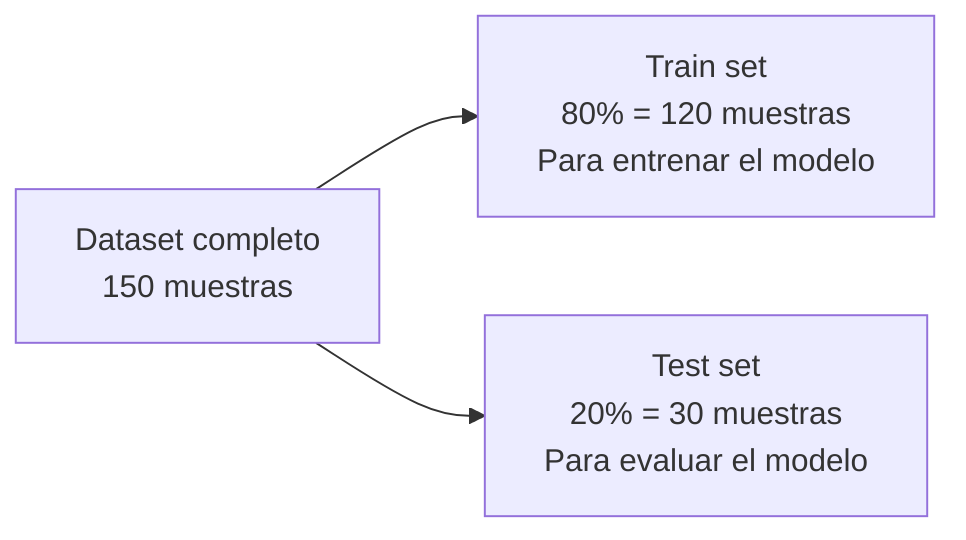
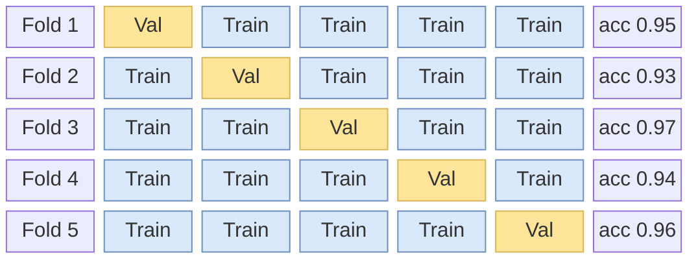
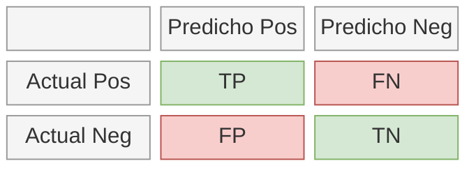
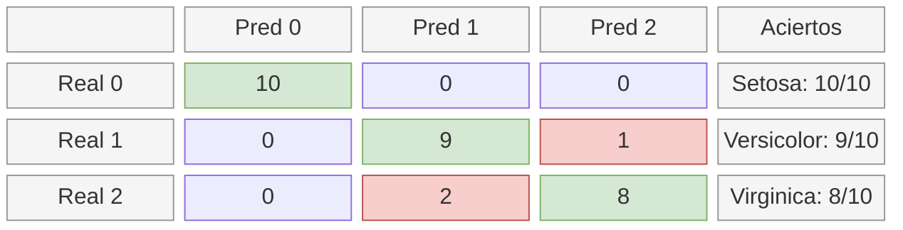
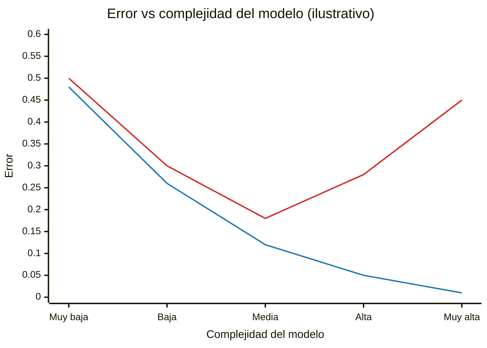

# Conceptos de Machine Learning para este Proyecto

Guía rápida de los conceptos ML que usamos.

---

## 1. Clasificación vs Regresión

| Tipo              | Output             | Ejemplo                             |
| ----------------- | ------------------ | ----------------------------------- |
| **Clasificación** | Categoría discreta | Flor: setosa, versicolor, virginica |
| Regresión         | Número continuo    | Precio: $150,000                    |

Este proyecto es de **clasificación multiclase** (3 clases).

---

## 2. Train/Test Split



**¿Por qué separar?**

- Evitar "hacer trampa" evaluando con datos que el modelo ya vio
- Simular cómo funcionará con datos nuevos

**random_state=42**: Semilla para reproducibilidad. Siempre obtienes la misma división.

---

## 3. Normalización (StandardScaler)

Transforma features para que tengan:

- Media = 0
- Desviación estándar = 1

```
Antes:  [5.1, 3.5, 1.4, 0.2]  (diferentes escalas)
Después: [-0.9, 1.0, -1.3, -1.3]  (misma escala)
```

**¿Por qué normalizar?**

- Algunos algoritmos son sensibles a la escala
- Mejora convergencia en gradient descent
- Random Forest no lo necesita estrictamente, pero es buena práctica

---

## 4. Validación Cruzada (Cross-Validation)

En lugar de un solo train/test split, hacemos varios:



Promedio: 0.95 ± 0.02 (valores ilustrativos). En cada fold, una parte distinta de los datos se usa como validación y el resto como entrenamiento.

**¿Por qué?**

- Más robusto que un solo split
- Detecta si el modelo es estable
- Usa todos los datos para entrenamiento y evaluación

---

## 5. Métricas de Evaluación

### Accuracy

```
Accuracy = Predicciones correctas / Total predicciones
         = 28/30 = 0.93
```

### Precision, Recall, F1

Para cada clase:



```
Precision = TP / (TP + FP)  → "De los que predije positivos, ¿cuántos lo eran?"
Recall    = TP / (TP + FN)  → "De los positivos reales, ¿cuántos encontré?"
F1        = 2 * (P * R) / (P + R)  → Balance entre precision y recall
```

### Matriz de Confusión



---

## 6. Probabilidades vs Predicción

```python
# Predicción: la clase más probable
model.predict([[5.1, 3.5, 1.4, 0.2]])
# Output: [0]  (clase 0 = setosa)

# Probabilidades: confianza por clase
model.predict_proba([[5.1, 3.5, 1.4, 0.2]])
# Output: [[0.95, 0.03, 0.02]]
#          setosa versicolor virginica
```

**¿Por qué retornar probabilidades?**

- Permite al cliente decidir umbral de confianza
- Útil para casos donde la predicción es incierta
- Mejor para debugging y análisis

---

## 7. Overfitting vs Underfitting



Curva roja: error en datos nuevos (validación). Curva azul: error en entrenamiento. A la izquierda hay underfitting (modelo simple); a la derecha, overfitting (modelo complejo).

**Underfitting**: Modelo muy simple, no captura patrones
**Overfitting**: Modelo memoriza datos de entrenamiento, no generaliza

**Random Forest evita overfitting** porque:

- Promedia muchos árboles (reduce varianza)
- Cada árbol ve subset aleatorio de datos y features

---

## 8. Hiperparámetros de Random Forest

| Parámetro           | Qué hace                      | Valor típico      |
| ------------------- | ----------------------------- | ----------------- |
| `n_estimators`      | Número de árboles             | 100               |
| `max_depth`         | Profundidad máxima            | None (sin límite) |
| `min_samples_split` | Mínimo para dividir nodo      | 2                 |
| `random_state`      | Semilla para reproducibilidad | 42                |

```python
RandomForestClassifier(
    n_estimators=100,      # Más árboles = más robusto, más lento
    max_depth=None,        # None = árboles crecen hasta ser puros
    min_samples_split=2,   # Mínimo 2 muestras para dividir
    random_state=42        # Reproducibilidad
)
```

---

## Recursos para Profundizar

- [Scikit-learn User Guide](https://scikit-learn.org/stable/user_guide.html)
- [Random Forest Explained](https://www.youtube.com/watch?v=J4Wdy0Wc_xQ)
- [Cross-Validation](https://scikit-learn.org/stable/modules/cross_validation.html)
